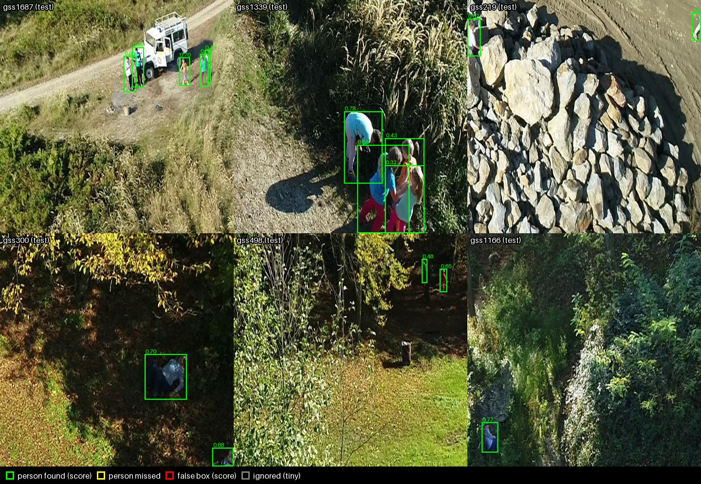

# Disaster Relief: Person Detection in Drone Imagery

Detecting people in aerial search-and-rescue footage with an open-vocabulary detector ([Grounding DINO](https://huggingface.co/IDEA-Research/grounding-dino-tiny)), with honest evaluation and, later, fine-tuning and calibrated recall guarantees.

The main dataset is SARD (Search and Rescue Image Dataset for Person Detection). HERIDAL and VisDrone are used as out-of-domain checks.



*Zero-shot detections on SARD test tiles (prompt `"person."`, threshold 0.3). These are hand-picked successes; see [Results](#results-so-far) for the averages and `results/figures/` for failure cases.*

## Project status

| Phase | Goal | Status |
|---|---|---|
| 0 | Environment and smoke test | Done |
| 1 | Data: COCO manifests and leak-free splits | Done (tag `phase1-splits`) |
| 2 | Zero-shot baseline, evaluation tooling, out-of-domain check | Done (tag `phase2-complete`) |
| 3 | Fine-tuning (head-only, then LoRA + head) on Colab | Next |
| 4 | Further fine-tuning variants and forgetting check | Planned |
| 5 | Conformal calibration for target recall | Planned (preliminary check done) |

## Setup

Requires macOS with Apple Silicon (MPS) or any machine with CUDA or CPU, and [Miniforge](https://github.com/conda-forge/miniforge).

```bash
conda create -n disaster python=3.11 -y
conda activate disaster
pip install torch torchvision
pip install -r requirements.txt
export PYTORCH_ENABLE_MPS_FALLBACK=1   # also set in .env for VS Code
```

`requirements.lock.txt` pins the exact versions used for the reported results. Run every script from the repository root, because paths are relative to it.

Check the install with the smoke test, which downloads the model (~700 MB) on first run:

```bash
python src/smoke.py path/to/image.jpg   # prints "N boxes on mps", writes smoke_out.jpg
```

## Data

Images are **not** in git. Put them under `data/raw/` (gitignored). The COCO manifests in `data/manifests/` are committed, and their `file_name` paths are relative to each dataset's root.

| Dataset | Source | Local path | Used for |
|---|---|---|---|
| SARD, Roboflow export (v17, 3×3 tiles, YOLO format, class `human`) | [Roboflow Universe](https://universe.roboflow.com/datasets-pdabr/sard-8xjhy/dataset/17); original on [IEEE DataPort](https://ieee-dataport.org/documents/search-and-rescue-image-dataset-person-detection-sard) (DOI 10.21227/ahxm-k331) | `data/raw/sard-roboflow-tiles/` | Train, val, calib, test |
| HERIDAL (test split) | Ultralytics Platform NDJSON export; `src/fetch_heridal.py` downloads the images | `data/raw/heridal/` | Out-of-domain check |
| VisDrone2019-DET val | [Ultralytics release](https://github.com/ultralytics/assets/releases/download/v0.0.0/VisDrone2019-DET-val.zip) | `data/raw/visdrone/unzipped/` | Out-of-domain check |

This SARD copy differs from the original release. It contains 5,755 tiles cut from 1,980 frames, each stretched to 640×640, with one `human` class. The original's pose labels (standing, lying and so on) are not included.

### Splits

The Roboflow train/val/test splits assign frames at random. As a result, 92% of test frames sit next to a near-identical training frame. `src/make_splits.py` re-splits the data:

- whole blocks of 40 consecutive frames go to one split;
- 5 frames are dropped at each boundary between different splits;
- boxes with a side under 4 px are marked as ignore regions (`iscrowd=1`).

| Split | Frames | Tiles | Boxes |
|---|---|---|---|
| train | 1,225 | 3,676 | 4,707 |
| val | 177 | 553 | 863 |
| calib | 218 | 586 | 754 |
| test | 210 | 539 | 620 |

The calib split is held out for conformal calibration (Phase 5). Use test only once, after settings are frozen on val.

## Repository layout

```
configs/            run configs (one YAML per experiment)
data/manifests/     COCO manifests (committed); sard/roboflow/ keeps the original splits
data/raw/           images (gitignored)
results/<run>/      per-run outputs: config.yaml, run.json (git commit, versions), cache/, metrics.json
results/metrics/    copies of every run's metrics (committed)
results/figures/    figure sheets for reports
src/
  smoke.py              Phase 0 smoke test
  convert_sard.py       SARD YOLO export -> COCO
  make_splits.py        leak-free block splits + ignore regions
  convert_external.py   HERIDAL / VisDrone -> COCO
  fetch_heridal.py      download a HERIDAL split from the NDJSON export
  make_tiles.py         cut 640 px native-resolution tiles and sample a subset
  utils.py              seeding, run directories, provenance, metrics saving
  baseline.py           run the model once per (prompt, scale); cache raw detections
  evaluate.py           COCO AP + precision/recall/F1 sweep from the cache (no inference)
  analyze.py            per-block AP, block bootstrap CIs, box counts by size
  recall_calibration.py preliminary target-vs-achieved recall
  show_examples.py      success/failure figure sheets
```

## Reproducing the pipeline

```bash
# Phase 1: data
python src/convert_sard.py            # -> data/manifests/sard/roboflow/
python src/make_splits.py             # -> data/manifests/sard/{train,val,calib,test}.json

# Phase 2: zero-shot baseline (inference cached; scoring is offline)
python src/baseline.py --config configs/baseline_val_full.yaml
python src/evaluate.py --run results/baseline-val-full
python src/analyze.py  --run results/baseline-val-full --variant person_s1

# Out-of-domain check
python src/fetch_heridal.py --split test
python src/convert_external.py heridal --split test
python src/make_tiles.py heridal --manifest full_test.json
python src/baseline.py --config configs/zeroshot_heridal.yaml
python src/evaluate.py --run results/zeroshot-heridal-tiles300
```

`baseline.py` saves every detection scoring at least 0.05, so threshold sweeps and calibration never re-run the model. An interrupted run resumes from its cache.

## Results so far

Zero-shot Grounding DINO (tiny). Settings were chosen on val and then frozen: prompt `"person."`, native scale, score threshold 0.3. Brackets show 95% block-bootstrap intervals.

| Split | Tiles | AP50 | AP50:95 | AP small | Precision / recall @ 0.3 |
|---|---|---|---|---|---|
| SARD val | 553 | 0.857 [0.806, 0.905] | 0.470 | 0.283 | 0.86 / 0.80 |
| SARD calib | 586 | 0.856 | 0.460 | 0.183 | 0.85 / 0.78 |
| SARD test | 539 | 0.753 [0.678, 0.835] | 0.413 | 0.092 (84 boxes) | 0.72 / 0.71 |
| HERIDAL (300 tiles) | 300 | 0.872 | 0.520 | 0.284 | 0.71 / 0.87 |
| VisDrone (300 tiles) | 300 | 0.542 | 0.237 | 0.210 | 0.71 / 0.43 |

What these results show:
- **Val vs test.** The gap is mostly scene-to-scene variation: each split has only 6–7 scene blocks, and the bootstrap intervals overlap.
- **Box-style mismatch.** Half of the test false boxes (84 of 168) are loose boxes on real people that overlap the label by less than 50%. Fine-tuning may close this, but part of any gain could be the model learning SARD's labelling style rather than detecting better.
- **Hardest real misses.** People in deep shadow or behind trees (see `results/figures/`).
- **Preliminary calibration.** Thresholds chosen on calib reach the target recall on val but fall 5–9 points short on test.

Per-condition results (pose, occlusion) are not available yet, because this SARD copy has no condition tags.

## Conventions

- Settings are chosen on **val**; **calib** is reserved for calibration; **test** is evaluated once per frozen setup.
- Every run writes `results/<run>/run.json` with the git commit and a dirty flag. Commit code before running.
- Metrics go to `results/metrics/` (tracked). Raw detection caches are force-added (`git add -f`) when later phases need them.
- Work happens on a branch per phase, merged to `main` when its checkpoint passes, with a tag per checkpoint.

## Citations and licences

- SARD: S. Sambolek and M. Ivašić-Kos, "Automatic person detection in search and rescue operations using deep CNN detectors," *IEEE Access*, 2021. Dataset DOI 10.21227/ahxm-k331. The Roboflow export lists its licence as undefined.
- HERIDAL: D. Božić-Štulić, Ž. Marušić and S. Gotovac, "Deep learning approach in aerial imagery for supporting land search and rescue missions," *IJCV*, 2019.
- VisDrone: P. Zhu et al., "Detection and tracking meet drones challenge," *IEEE TPAMI*, 2021. For academic, non-commercial use.
- Grounding DINO: S. Liu et al., "Grounding DINO: Marrying DINO with grounded pre-training for open-set object detection," *ECCV*, 2024.
